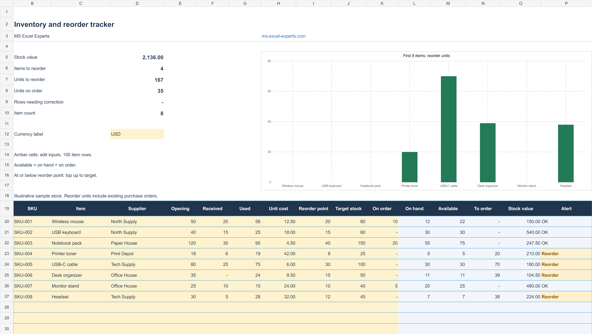

# Inventory and Reorder Tracker

An Excel inventory tracker for reviewing stock quantities, estimating stock value, and planning replenishment.

## Template preview

## Features

- **100 item rows:** organize SKUs, item names, and suppliers in a filterable table.
- **Stock quantities:** record opening stock, receipts, and usage for the same period.
- **On-hand calculation:** calculate opening stock plus receipts minus usage.
- **Available stock:** include quantities already on order when planning replenishment.
- **Reorder points and targets:** define the threshold and desired stock level for each item.
- **Suggested order quantities:** top up to the target when available stock reaches or falls below the reorder point.
- **Stock valuation:** calculate on-hand quantity multiplied by the entered unit cost.
- **Summary totals:** review stock value, reorder items, units to order, and quantities already on order.
- **Reorder chart:** compare suggested order quantities for the first 8 items.
- **Data alerts:** flag missing inputs, negative stock, and targets below reorder points.

The preview uses illustrative sample stock. Unit costs are entered manually in one currency. Quantities already on order reduce the suggested replenishment quantity.

## Adapt inventory reporting to your business

You can <a href="https://ms-excel-experts.com/">hire excel experts</a> to discuss stock tracking for your products and suppliers.

Share your requirements with our <a href="https://ms-excel-experts.com/">spreadsheets experts</a>. Explore <a href="https://ms-excel-experts.com/">custom inventory spreadsheets</a> for your stock reporting process.
